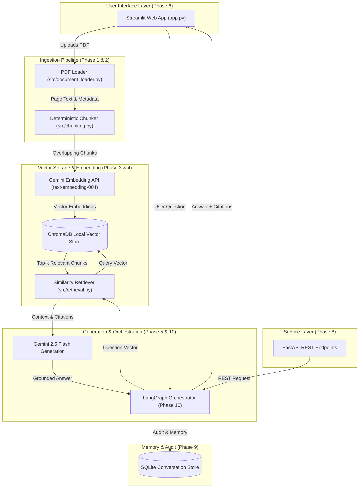

# Enterprise Knowledge Copilot — Architecture & System Design

> **Document Status**: Active / Phased Architecture Plan  
> **Current Version**: Phase 1 Foundation  
> **Last Updated**: October 2026  

---

## 1. Executive Summary

**Enterprise Knowledge Copilot** is a production-minded document assistant designed to let users upload enterprise documents (PDFs), ask questions about their content, and receive accurate, grounded answers accompanied by verifiable source citations (filename and page numbers).

The system is designed to run efficiently on resource-constrained environments (limited RAM, minimal disk consumption) by relying on lightweight local components and free-tier cloud APIs (Google Gemini) rather than heavy local LLM runtimes.

---

## 2. High-Level Architecture

The system follows an incremental, modular architecture with clear separation of concerns:

---

## 3. Implementation Status: Current vs. Planned

To maintain transparency and engineering rigor, the table below highlights exactly what is implemented today versus what is planned for future phases:

| Component / Feature | Current Status | Implemented Phase | Target Phase |
| :--- | :--- | :--- | :--- |
| **Directory Structure & Config** | **Implemented** | Phase 1 | Phase 1 |
| **Deterministic Chunking & Tests** | **Implemented** | Phase 1 | Phase 1 |
| **PDF Extraction (`pypdf`)** | **Implemented** | Phase 1 | Phase 1 |
| **Unit Test Suite (`pytest`)** | **Implemented** | Phase 1 | Phase 1 |
| **PDF Upload Validation & UI** | Planned | — | Phase 2 |
| **Gemini Embeddings Integration** | Planned | — | Phase 3 |
| **ChromaDB Vector Store** | Planned | — | Phase 3 |
| **Semantic Retrieval (Top-k)** | Planned | — | Phase 4 |
| **Grounded Gemini Q&A with Citations** | Planned | — | Phase 5 |
| **Streamlit Interactive UI** | Planned | — | Phase 6 |
| **Short-term Conversation History** | Planned | — | Phase 7 |
| **FastAPI REST Endpoints** | Planned | — | Phase 8 |
| **SQLite Persistent Memory** | Planned | — | Phase 9 |
| **LangGraph Workflow Orchestration** | Planned | — | Phase 10 |
| **RAG Evaluation & Injection Defense** | Planned | — | Phase 11 |
| **Interview Prep & Demo Packaging** | Planned | — | Phase 12 |

---

## 4. Phase 1 Foundation Details

### 4.1 Configuration Management (`src/config.py`)
- Employs an immutable `AppConfig` dataclass loaded via `python-dotenv`.
- Validates chunking boundaries (`chunk_size > 0`, `chunk_overlap >= 0`, `chunk_overlap < chunk_size`).
- Validates model names without hardcoding them in business logic.
- API key validation is isolated from initial imports so unit tests run 100% offline with zero dependencies on external network or paid services.
- Secret masking: `repr(config)` explicitly redacts the `GEMINI_API_KEY` to prevent accidental log leaks.

### 4.2 Document Loader (`src/document_loader.py`)
- Reads PDFs using `pypdf.PdfReader` on a page-by-page basis.
- Normalizes newline characters (`\r\n` to `\n`) and strips null bytes (`\x00`).
- Enforces strict input validation: rejects missing files, directories, non-PDF extensions, and 0-byte corrupt files.
- Attaches citation-critical metadata: `page_number` (1-indexed), `source_filename`, and character statistics.

### 4.3 Deterministic Text Chunking (`src/chunking.py`)
- Splits text into overlapping sliding-window chunks:
  $$\text{step\_size} = \text{chunk\_size} - \text{chunk\_overlap}$$
- Assigns deterministic, collision-resistant chunk IDs:
  $$\text{chunk\_id} = f"{filename}\_p\{page\}\_c\{chunk\_index\}\_\{hash\}$$
- Preserves precise character offsets (`char_start`, `char_end`) for auditability.
- Deduplication support (`deduplicate=True`) prevents redundant embedding of repeated boilerplate (e.g. repeated headers/footers across pages).

---

## 5. Security and Operational Guidelines

1. **Untrusted Data Isolation**: Document content uploaded by users is treated strictly as untrusted evidence data, never as system instructions.
2. **Secret Hygiene**: Real API keys are never stored in source files, repositories, or error messages.
3. **Storage & Memory Footprint**: No local LLMs or container runtimes (Docker/Ollama) are used. Persistence uses lightweight local SQLite and disk-backed ChromaDB.
4. **Citation Discipline**: Answers must cite source filename and page numbers. When the retrieved evidence is insufficient, the system explicitly acknowledges the gap rather than hallucinating.
