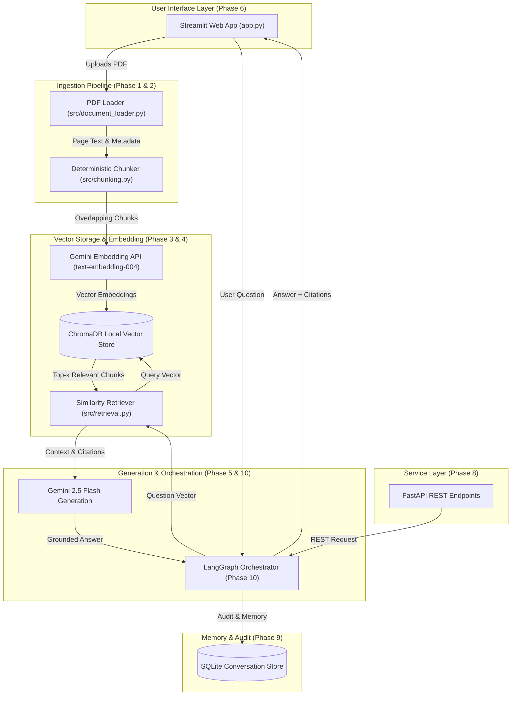

# Enterprise Knowledge Copilot — Architecture & System Design

> **Document Status**: Active / Phased Architecture Plan  
> **Current Version**: Phase 5 Verified (Grounded LLM Answer Generation with Verifiable Citations)  
> **Last Updated**: October 2026  

---

## 1. Executive Summary

**Enterprise Knowledge Copilot** is a production-minded document assistant designed to let users upload enterprise documents (PDFs), ask questions about their content, and receive accurate, grounded answers accompanied by verifiable source citations (filename and page numbers).

The system is designed to run efficiently on resource-constrained environments (limited RAM, minimal disk consumption) by relying on lightweight local components and free-tier cloud APIs (Google Gemini) rather than heavy local LLM runtimes.

---

## 2. Document Processing Pipeline (Phase 2 Flow)

Phase 2 establishes the end-to-end document preparation workflow prior to vector embedding:

```mermaid
flowchart LR
    PDFInput["PDF Upload (Bytes / File)"] --> Validation["Validation (Signature, Size, Encryption)"]
    Validation --> SafeStorage["Safe Storage (Sanitized UUID in data/uploads/)"]
    SafeStorage --> Extraction["Page Extraction (pypdf + Whitespace Normalization)"]
    Extraction --> ScannedCheck{"Extractable Text?"}
    ScannedCheck -->|No (0 chars)| ScannedError["ScannedPdfError (OCR Not Implemented)"]
    ScannedCheck -->|Yes| Chunker["Page-Bounded Chunker (chunk_pages)"]
    Chunker --> Output["Metadata-Preserving Chunks (source, page, chunk_id)"]
```

---

## 3. Grounded RAG Query Pipeline (Phase 5 Flow)

Phase 5 establishes the end-to-end question answering and citation verification workflow:

```mermaid
flowchart TD
    UserQ["User Question"] --> ValidateQ["Validate Question (Non-empty string)"]
    ValidateQ --> CheckDocs{"Indexed Documents Exist?"}
    CheckDocs -->|No (0 chunks)| StatusNoDocs["Status: no_documents"]
    CheckDocs -->|Yes| SearchChunks["Semantic Retrieval (src/retrieval.py)"]
    SearchChunks --> CheckHits{"Usable Evidence?"}
    CheckHits -->|No / Filtered out| StatusInsufficient["Status: insufficient_evidence"]
    CheckHits -->|Yes| BuildContext["Context Construction (RAG_MAX_CONTEXT_CHARS Budget)"]
    BuildContext --> AssignRefs["Assign Reference IDs ([S1], [S2], ...)"]
    AssignRefs --> GeminiCall["Gemini 2.5 Flash Generation (Strict Grounding Prompt)"]
    GeminiCall --> CitationsValidator["Deterministic Citation Validation (Python)"]
    CitationsValidator --> MapCitations["Map Valid IDs -> [source, p. page] & Strip Invalid IDs"]
    MapCitations --> FinalResult["Final Structured Answer + Citations Dictionary"]
```

---

## 4. High-Level Architecture

The system follows an incremental, modular architecture with clear separation of concerns:



---

## 3. Implementation Status: Current vs. Planned

To maintain transparency and engineering rigor, the table below highlights exactly what is implemented today versus what is planned for future phases:

| Component / Feature | Current Status | Implemented Phase | Target Phase |
| :--- | :--- | :--- | :--- |
| **Directory Structure & Config** | **Implemented** | Phase 1 | Phase 1 |
| **Deterministic Chunking & Tests** | **Implemented** | Phase 1 | Phase 1 |
| **PDF Extraction (`pypdf`)** | **Implemented** | Phase 1 | Phase 1 |
| **PDF Upload Validation & Storage** | **Implemented** | Phase 2 | Phase 2 |
| **Scanned Document Detection** | **Implemented** | Phase 2 | Phase 2 |
| **Gemini Embeddings Integration** | **Implemented** | Phase 3 | Phase 3 |
| **ChromaDB Vector Store** | **Implemented** | Phase 3 | Phase 3 |
| **Document Indexing Pipeline** | **Implemented** | Phase 3 | Phase 3 |
| **Initial Retrieval Interface** | **Implemented** | Phase 3 | Phase 3 |
| **Semantic Retrieval & Relevance Checks** | **Implemented** | Phase 4 | Phase 4 |
| **Retrieval Evaluation Metrics (Recall/MRR)** | **Implemented** | Phase 4 | Phase 4 |
| **Grounded Gemini Q&A with Citations** | **Implemented** | Phase 5 | Phase 5 |
| **Unit Test Suite (`pytest`)** | **Implemented** | Phase 1–5 | Phase 1–5 |
| **Streamlit Interactive UI** | Planned | — | Phase 6 |
| **Short-term Conversation History** | Planned | — | Phase 7 |
| **FastAPI REST Endpoints** | Planned | — | Phase 8 |
| **SQLite Persistent Memory** | Planned | — | Phase 9 |
| **LangGraph Workflow Orchestration** | Planned | — | Phase 10 |
| **RAG Evaluation & Injection Defense** | Planned | — | Phase 11 |
| **Interview Prep & Demo Packaging** | Planned | — | Phase 12 |

---

## 4. Phase 1 Foundation Details

### 4.1 Configuration Management (`src/config.py`)
- Employs an immutable `AppConfig` dataclass loaded via `python-dotenv`.
- Validates chunking boundaries (`chunk_size > 0`, `chunk_overlap >= 0`, `chunk_overlap < chunk_size`).
- Validates model names without hardcoding them in business logic.
- API key validation is isolated from initial imports so unit tests run 100% offline with zero dependencies on external network or paid services.
- Secret masking: `repr(config)` explicitly redacts the `GEMINI_API_KEY` to prevent accidental log leaks.

### 4.2 Document Loader (`src/document_loader.py`)
- Reads PDFs using `pypdf.PdfReader` on a page-by-page basis.
- Normalizes newline characters (`\r\n` to `\n`) and strips null bytes (`\x00`).
- Enforces strict input validation: rejects missing files, directories, non-PDF extensions, and 0-byte corrupt files.
- Attaches citation-critical metadata: `page_number` (1-indexed), `source_filename`, and character statistics.

### 4.3 Deterministic Text Chunking (`src/chunking.py`)
- Splits text into overlapping sliding-window chunks:
  $$\text{step\_size} = \text{chunk\_size} - \text{chunk\_overlap}$$
- Assigns deterministic, collision-resistant chunk IDs:
  $$\text{chunk\_id} = f"{filename}\_p\{page\}\_c\{chunk\_index\}\_\{hash\}$$
- Preserves precise character offsets (`char_start`, `char_end`) for auditability.
- Deduplication support (`deduplicate=True`) prevents redundant embedding of repeated boilerplate (e.g. repeated headers/footers across pages).

### 4.4 Semantic Retrieval & Relevance Calibration (`src/retrieval.py` & `src/evaluation.py`)
- **Query Vectorization**: Generates search query vectors with Gemini `task_type='RETRIEVAL_QUERY'`, ensuring alignment with stored document chunk representations (`task_type='RETRIEVAL_DOCUMENT'`).
- **Bounded Top-k**: Guarantees bounded query size (`top_k <= RETRIEVAL_MAX_TOP_K`) to protect system memory and downstream LLM context windows.
- **Distance Thresholding**: Employs cosine distance filtering (`distance <= max_distance`), suppressing irrelevant chunks before they reach downstream LLM prompts.
- **Source Filtering**: Enables document routing (`source_filter="handbook.pdf"`) via ChromaDB metadata clauses.
- **Context Formatting (`format_retrieval_context`)**: Formats retrieved passages into clean markdown blocks containing passage IDs, source filenames, and 1-indexed page citations.
- **Evaluation Metrics**: Provides deterministic offline calculation of:
  - $\text{Recall@k} = \frac{|\text{Retrieved}_k \cap \text{Expected}|}{|\text{Expected}|}$
  - $\text{Precision@k} = \frac{|\text{Retrieved}_k \cap \text{Expected}|}{|\text{Retrieved}_k|}$
  - $\text{MRR} = \frac{1}{N} \sum_{i=1}^N \frac{1}{\text{rank of first relevant chunk}}$

### 4.5 Grounded Answer Generation & Citation Validation (`src/rag_pipeline.py`)
- **Strict Evidence Grounding**: System instructions require Gemini 2.5 Flash to synthesize answers strictly from retrieved passages, never hallucinating outside facts.
- **Prompt Injection Defense**: Injected instructions inside PDF documents are treated as untrusted data rather than system commands.
- **Reference Labeling (`[S1]`, `[S2]`)**: Retrieved chunks are assigned application-controlled reference IDs in the prompt context.
- **Deterministic Citation Validation**: Python validates all model citations against the query's trusted reference dictionary, mapping valid references to verified citations (`[<source>, p. <page>]`) and safely discarding hallucinated or unknown IDs (`[S99]`).
- **Context Budgeting**: Enforces `RAG_MAX_CONTEXT_CHARS` without cutting chunks mid-sentence.
- **Honest Absence Reporting**: Directly outputs an `insufficient_evidence` fallback when relevant evidence is lacking, preventing fabricated answers.

---

## 5. Security and Operational Guidelines

1. **Untrusted Data Isolation**: Document content uploaded by users is treated strictly as untrusted evidence data, never as system instructions.
2. **Secret Hygiene**: Real API keys are never stored in source files, repositories, or error messages.
3. **Storage & Memory Footprint**: No local LLMs or container runtimes (Docker/Ollama) are used. Persistence uses lightweight local SQLite and disk-backed ChromaDB.
4. **Citation Discipline**: Answers must cite source filename and page numbers. When the retrieved evidence is insufficient, the system explicitly acknowledges the gap rather than hallucinating.
